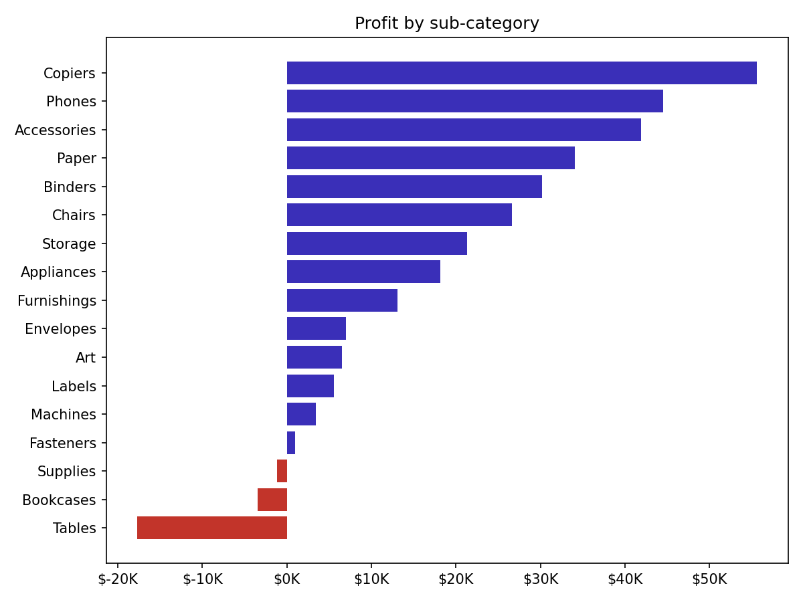
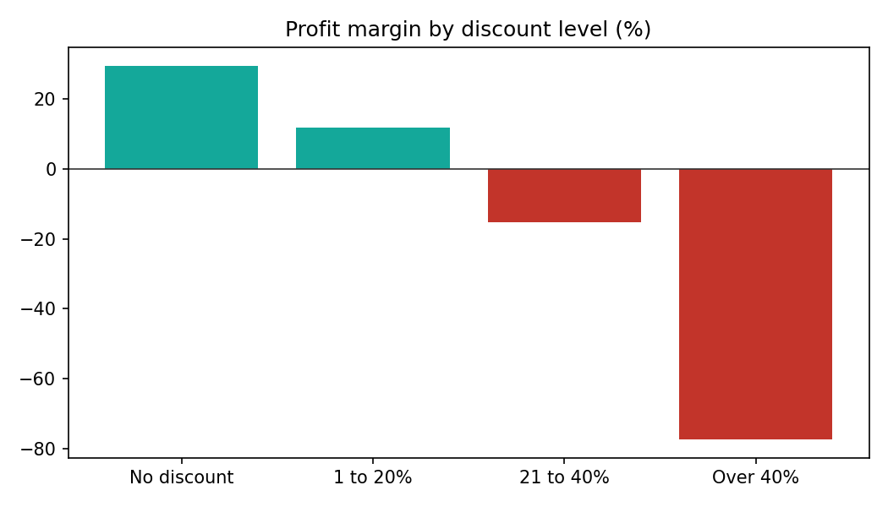
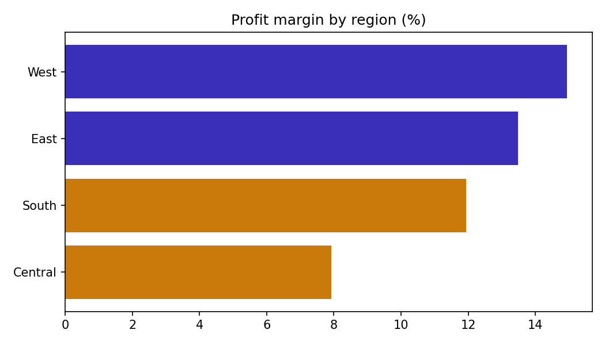

# BUAINESS SALES PERFORMANCE DASHBOARD


A two-page Power BI dashboard analysing the Sample - Superstore dataset (US retail orders, Jan 2014 to Dec 2017), built for the Future Interns Data Science & Analytics Task 1 (2026).

## Dashboard preview

**Page 1: Dashboard**


**Page 2: Findings**


## Business questions

1. Which products and categories generate the most revenue and profit?
2. How do sales change over time?
3. Which regions and customer segments perform best?
4. Where should the business focus to grow faster?

## The dashboard

**Page 1: Dashboard**
- Slicers for year, region, category and segment
- Five KPI cards: sales, profit, profit margin, orders and average order value
- Sales and profit by month, with year-on-year comparison on the cards
- Top 8 products by sales
- Sales by category and region
- Top 8 sub-categories by profit
- Sales and margin by discount level

**Page 2: Findings**
- Key insights and recommended actions, written for a business owner

## Data preparation

- The file is encoded as Latin-1, so it is read with that encoding and saved as UTF-8 (`data/superstore_clean.csv`).
- Order Date and Ship Date were parsed as `M/D/YYYY`. No ship date falls before its order date.
- No missing values and no duplicate rows: 9,994 order lines, 5,009 distinct orders and 793 customers.
- 438 postal codes (New England states and New Jersey) lost their leading zero in the source file, so they were restored as 5-character text. Postal code is not used in the analysis.
- A `Discount Band` column was added: No discount, 1 to 20%, 21 to 40%, Over 40%.
- A calendar table was built in DAX and related to Order Date for year-on-year measures.

**Main measures (DAX):** Total Sales, Total Profit, Profit Margin (profit divided by sales), Orders (distinct Order IDs), Avg Order Value, prior-year and year-on-year versions of each, and a margin colour rule (red for a loss, amber under 12%, otherwise indigo).

## Key results (2014 to 2017)

| Measure | Value |
|---|---|
| Sales | $2.30M |
| Profit | $286K |
| Profit margin | 12.5% |
| Orders | 5,009 |
| Average order value | $459 |

| Year | Sales | Profit | Margin | Orders |
|---|---|---|---|---|
| 2014 | $484K | $49.5K | 10.2% | 969 |
| 2015 | $471K | $61.6K | 13.1% | 1,038 |
| 2016 | $609K | $81.8K | 13.4% | 1,315 |
| 2017 | $733K | $93.4K | 12.7% | 1,687 |

## Key insights

1. **Strong growth.** Sales have grown 51% since 2014 and rose 20% in 2017 to $733K.
2. **Growth comes from volume, not basket size.** Orders rose 28% in 2017, but average order value fell 6% (from $463 to $435) and margin slipped from 13.4% to 12.7%.
3. **Technology and Office Supplies carry the profit.** Together they earn 94% of profit. Furniture is 32% of sales but only 6% of profit, at a 2.5% margin.
4. **Discounts are the biggest profit leak.** Lines discounted by more than 20% are 14% of all lines but lost $135K. Margin is 30% with no discount, 12% at 1 to 20%, -15% at 21 to 40% and -77% above 40%.
5. **Three sub-categories lose money:** Tables (-$17.7K), Bookcases (-$3.5K) and Supplies (-$1.2K). Machines is close to break-even (1.8% margin). Copiers earn $55.6K, 19% of all profit, from only 68 orders.
6. **Central is the weakest region.** Its margin is 7.9%, against 14.9% in West, 13.5% in East and 11.9% in South. Central's average discount is 24%, against 11% in West.
7. **Sales are seasonal.** September, November and December bring 43% of annual sales. January and February bring just 7%.
8. **Some top sellers earn nothing.** Cisco TelePresence EX90 ranks third by sales ($22.6K) but loses $1.8K, and HON 5400 chairs ($21.9K) earn zero profit. The top 8 products are only 9% of sales, so the range is wide.
9. **Segments:** Consumer is the largest segment (51% of sales) with the lowest margin (11.5%). Home Office earns the highest margin (14.0%).

## Recommendations

1. **Cap discounts at 20%** and require manager approval above it. Lines above 20% lost $135K, equal to 47% of total profit.
2. **Reprice Tables and Bookcases**, or stop discounting them. Also review the 299 products that lose money, which cost $77K together.
3. **Bring Central's discounting in line with West.** Matching West's margin would add about $35K over the four years.
4. **Push the profit engines.** Bundle Copiers, Phones and Accessories, and use Paper, Labels and Envelopes (40%+ margins) as add-ons to lift order value.
5. **Stock up and start campaigns from September.** Lift January and February with bundles and free-shipping offers rather than deep discounts.
6. **Reprice top sellers that earn nothing,** such as the Cisco TelePresence EX90 and the HON 5400 chairs.

## Python data checks

Python (pandas) was used to check the raw file before it went into Power BI, and to confirm that the dashboard totals are correct. The script is `python/superstore_data_check.py`. It runs seven steps: load, quality checks, clean, reconcile with Power BI, analysis tables, insight check and charts.

```
pip install -r python/requirements.txt
python python/superstore_data_check.py "data/Sample - Superstore.csv"
```

Everything below is the real code from the script and the real output from running it on the Superstore file. The full console output is in `python/sample_output/console_output.txt`, and the summary tables and charts are in the same folder.

### Step 1 and 2: load the file and check its quality

```python
section("1. LOAD AND INSPECT")
# The file is Latin-1 encoded. Postal Code is read as text to keep leading zeros.
df = pd.read_csv(SRC, encoding="latin-1", dtype={"Postal Code": str})
print(f"Rows: {len(df):,}   Columns: {df.shape[1]}")
print(df.dtypes.to_string())

section("2. DATA QUALITY CHECKS")
issues = []

missing = df.isna().sum()
print("Missing values:", "none" if missing.sum() == 0 else missing[missing > 0].to_dict())
if missing.sum():
    issues.append("missing values")

print("Duplicate rows:", df.duplicated().sum(), "| duplicate Row IDs:", df["Row ID"].duplicated().sum())
if df.duplicated().sum() or df["Row ID"].duplicated().sum():
    issues.append("duplicates")

for col in ["Order Date", "Ship Date"]:
    df[col] = pd.to_datetime(df[col], format="%m/%d/%Y")
print(f"Order dates: {df['Order Date'].min().date()} to {df['Order Date'].max().date()}")
bad_ship = (df["Ship Date"] < df["Order Date"]).sum()
print("Ship date before order date:", bad_ship)
print("Days to ship (mean/max):", round((df["Ship Date"] - df["Order Date"]).dt.days.mean(), 1),
      (df["Ship Date"] - df["Order Date"]).dt.days.max())
if bad_ship:
    issues.append("ship date before order date")

print("Sales <= 0:", (df.Sales <= 0).sum(), "| Quantity <= 0:", (df.Quantity <= 0).sum(),
      "| Discount outside 0-1:", (~df.Discount.between(0, 1)).sum())
print("Loss-making lines:", (df.Profit < 0).sum(), f"({(df.Profit < 0).mean() * 100:.1f}%)")

short_zip = (df["Postal Code"].str.len() < 5).sum()
print("Postal codes under 5 digits (leading zero lost):", short_zip)

for col in ["Region", "Category", "Segment", "Ship Mode"]:
    vals = sorted(df[col].unique())
    padded = (df[col] != df[col].str.strip()).sum()
    print(f"{col}: {vals} | untrimmed text: {padded}")

sub_map = df.groupby("Sub-Category").Category.nunique()
print("Sub-categories mapped to more than one category:", int((sub_map > 1).sum()))

order_dates = df.groupby("Order ID")["Order Date"].nunique()
print("Orders with more than one order date:", int((order_dates > 1).sum()))

q1, q3 = df.Sales.quantile([.25, .75])
upper = q3 + 1.5 * (q3 - q1)
print(f"Sales outliers (above {upper:,.0f}): {(df.Sales > upper).sum()} lines "
      "(large machines and furniture, so kept)")

print("\nResult:", "no blocking issues found" if not issues else f"issues found: {issues}")
```

Output:

```text
Missing values: none
Duplicate rows: 0 | duplicate Row IDs: 0
Order dates: 2014-01-03 to 2017-12-30
Ship date before order date: 0
Days to ship (mean/max): 4.0 7
Sales <= 0: 0 | Quantity <= 0: 0 | Discount outside 0-1: 0
Loss-making lines: 1871 (18.7%)
Postal codes under 5 digits (leading zero lost): 438
Region: ['Central', 'East', 'South', 'West'] | untrimmed text: 0
Category: ['Furniture', 'Office Supplies', 'Technology'] | untrimmed text: 0
Segment: ['Consumer', 'Corporate', 'Home Office'] | untrimmed text: 0
Ship Mode: ['First Class', 'Same Day', 'Second Class', 'Standard Class'] | untrimmed text: 0
Sub-categories mapped to more than one category: 0
Orders with more than one order date: 0
Sales outliers (above 499): 1167 lines (large machines and furniture, so kept)

Result: no blocking issues found
```

Findings from the checks: there were no missing values, duplicates or date errors. The only fix needed was 438 postal codes that had lost their leading zero.

### Step 3: clean the data and add the Discount Band

```python
section("3. CLEAN AND SAVE")
for col in ["Region", "Category", "Sub-Category", "Segment", "Ship Mode", "Product Name"]:
    df[col] = df[col].str.strip()
df["Postal Code"] = df["Postal Code"].str.zfill(5)
df["Year"] = df["Order Date"].dt.year
df["Month"] = df["Order Date"].dt.month
df["Quarter"] = df["Order Date"].dt.quarter
df["Discount Band"] = pd.cut(df.Discount, [-0.001, 0, 0.2, 0.4, 1.0],
                             labels=["No discount", "1 to 20%", "21 to 40%", "Over 40%"])
df["Discount Band Order"] = df["Discount Band"].cat.codes + 1
clean = df.copy()
clean["Order Date"] = clean["Order Date"].dt.strftime("%Y-%m-%d")
clean["Ship Date"] = clean["Ship Date"].dt.strftime("%Y-%m-%d")
clean.to_csv(OUT / "superstore_clean.csv", index=False)
print("Saved", OUT / "superstore_clean.csv")
```

This produces the cleaned file used by Power BI (`data/superstore_clean.csv`), with ISO dates, 5-digit postal codes, and the Year, Month, Quarter and Discount Band columns.

### Step 4: reconcile the totals with Power BI

The script holds the totals the dashboard should show and compares them with what pandas calculates from the file:

```python
EXPECTED = {"Rows": 9994, "Orders": 5009, "Customers": 793,
            "Sales": 2297200.86, "Profit": 286397.02}
```

```python
section("4. RECONCILE WITH POWER BI")
actual = {"Rows": len(df), "Orders": df["Order ID"].nunique(),
          "Customers": df["Customer ID"].nunique(),
          "Sales": round(df.Sales.sum(), 2), "Profit": round(df.Profit.sum(), 2)}
for k, v in EXPECTED.items():
    ok = abs(actual[k] - v) < 0.01
    print(f"{k:10} python {actual[k]:>14,.2f}   power bi {v:>14,.2f}   {'PASS' if ok else 'CHECK'}")
```

Output:

```text
Rows       python       9,994.00   power bi       9,994.00   PASS
Orders     python       5,009.00   power bi       5,009.00   PASS
Customers  python         793.00   power bi         793.00   PASS
Sales      python   2,297,200.86   power bi   2,297,200.86   PASS
Profit     python     286,397.02   power bi     286,397.02   PASS
```

The Python totals agree with the Power BI cards ($2.30M sales, $286K profit, 12.5% margin, 5,009 orders). The cards show rounded values, so to check Power BI to the cent, set a card's Display units to None and compare it with the figures above.

### Step 5: analysis tables behind the dashboard

A helper function builds sales, profit, margin, orders and shares for any grouping:

```python
def summarise(frame, by):
    """Sales, profit, margin, orders and shares for any grouping."""
    t = frame.groupby(by).agg(sales=("Sales", "sum"), profit=("Profit", "sum"),
                              orders=("Order ID", "nunique"), lines=("Row ID", "count"))
    t["margin_pct"] = t.profit / t.sales * 100
    t["sales_share_pct"] = t.sales / frame.Sales.sum() * 100
    t["profit_share_pct"] = t.profit / frame.Profit.sum() * 100
    t["avg_order_value"] = t.sales / t.orders
    return t.round(2)
```

Output (a selection):

```text
Sales $2,297,201 | Profit $286,397 | Margin 12.5% | AOV $459

by_year
          sales    profit  margin_pct  orders
Year                                         
2014  484247.50  49543.97       10.23     969
2015  470532.51  61618.60       13.10    1038
2016  609205.60  81795.17       13.43    1315
2017  733215.26  93439.27       12.74    1687

by_category
                     sales     profit  margin_pct  orders
Category                                                 
Furniture        741999.80   18451.27        2.49    1764
Office Supplies  719047.03  122490.80       17.04    3742
Technology       836154.03  145454.95       17.40    1544

by_region
             sales     profit  margin_pct  orders
Region                                           
Central  501239.89   39706.36        7.92    1175
East     678781.24   91522.78       13.48    1401
South    391721.90   46749.43       11.93     822
West     725457.82  108418.45       14.94    1611

by_discount_band
                    sales     profit  margin_pct  orders
Discount Band                                           
No discount    1087908.47  320987.60       29.51    2644
1 to 20%        846522.24  100785.47       11.91    2507
21 to 40%       234137.90  -35817.47      -15.30     400
Over 40%        128632.25  -99558.59      -77.40     737
```

### Step 6: insights calculated from the data

Every number in the findings and recommendations comes from this step, so none is typed by hand:

```text
1. Sales grew 51% since 2014 and 20% in 2017.
2. Orders +28% in 2017, average order value -6%, margin 13.4% to 12.7%.
3. Technology + Office Supplies earn 94% of profit; Furniture is 32% of sales, 6% of profit, 2.5% margin.
4. Lines discounted over 20%: 14% of lines, profit -$135,376 (47% of total profit lost).
   Margin by discount band: {'No discount': 30.0, '1 to 20%': 12.0, '21 to 40%': -15.0, 'Over 40%': -77.0}
5. Loss-making sub-categories: {'Supplies': '-$1,189', 'Bookcases': '-$3,473', 'Tables': '-$17,725'}
6. Central margin 7.9% vs West 14.9%; matching West adds $35,187.
7. Sep + Nov + Dec = 43% of sales; Jan + Feb = 7%.
8. 299 products lose money, -$77,068 in total.
```

### Charts






## Limitations

- This is a sample dataset covering 2014 to 2017, so conclusions apply to that period.
- The link between deep discounts and losses is strong but is an association. Product mix also matters. For example, Tables lost $11.0K in East at a 37% average discount, while in West at 20% they made a small profit.
- The savings figures ($135K, $35K) are upper limits and assume sales volumes would hold if discounts were reduced.

## Repository structure

```
superstore-sales-performance-dashboard/
├── Superstore_Sales_Dashboard.pbix
├── README.md
├── data/
│   ├── Sample - Superstore.csv
│   └── superstore_clean.csv
├── python/
│   ├── superstore_data_check.py
│   ├── requirements.txt
│   └── sample_output/        (console output, summary tables, charts)
└── screenshots/
    ├── page1_dashboard.png
    └── page2_findings.png
```

## Tools

- **Power BI Desktop** (with DAX) for the data model, measures and the two-page dashboard
- **Microsoft Excel** for opening and reviewing the raw and cleaned CSV files
- **Python (pandas)** for data-quality checks and reconciliation (see Python data checks)

## Data source

https://www.kaggle.com/datasets/vivek468/superstore-dataset-final
